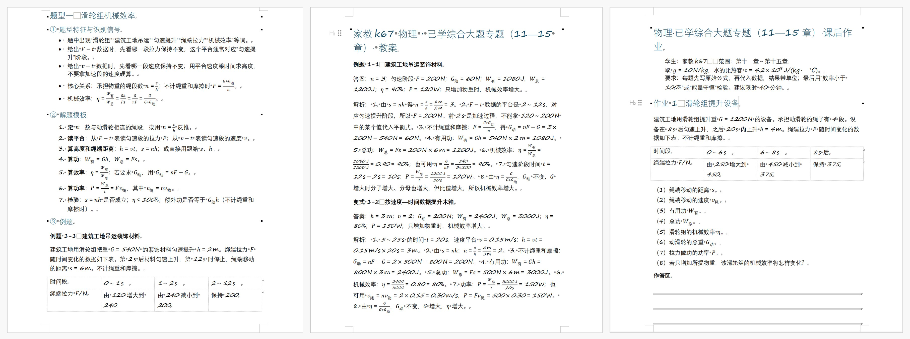
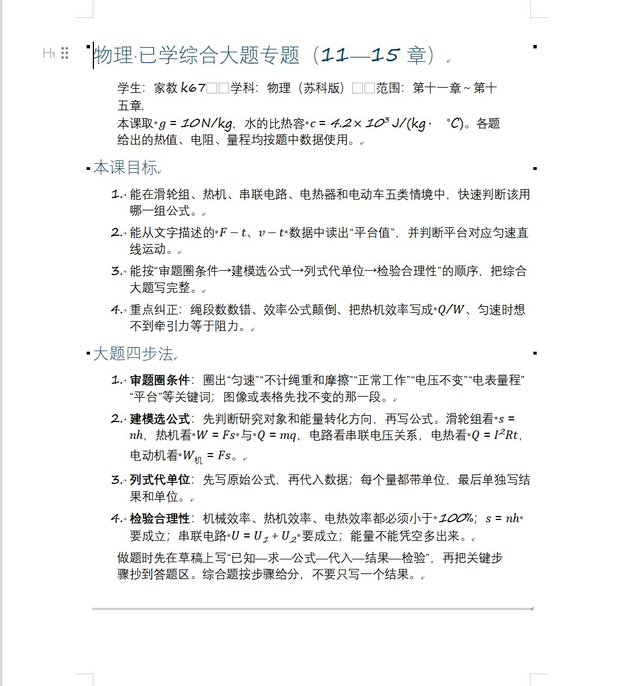
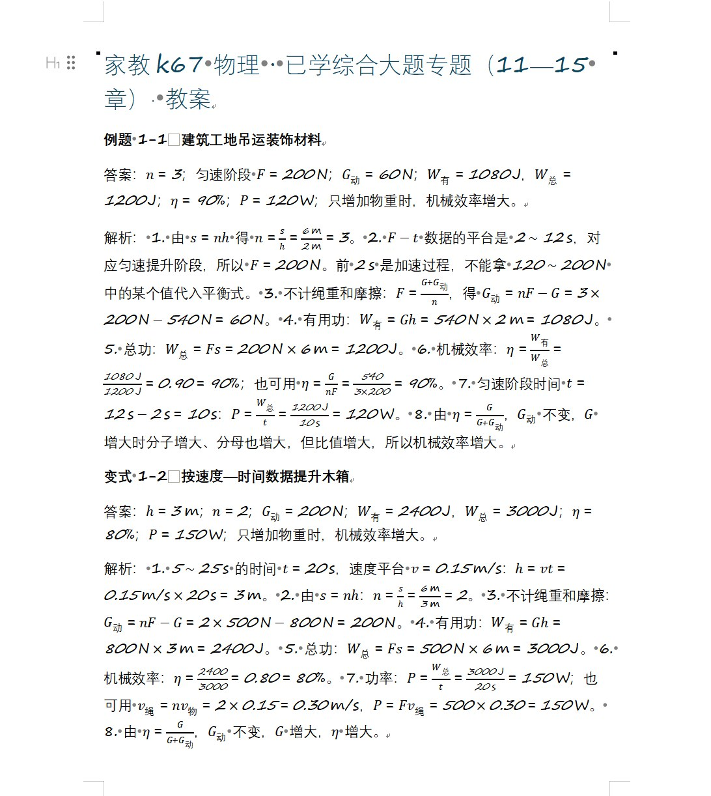
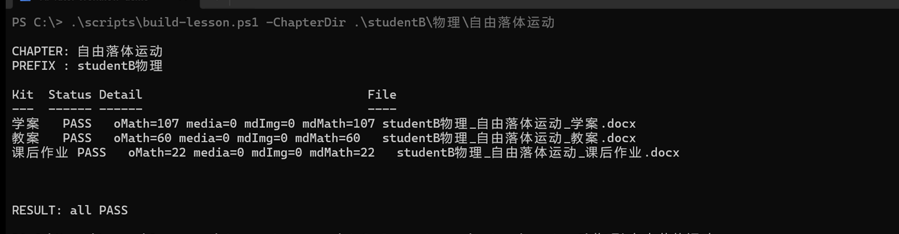

# AI-Tutor-Workflow · 极简家教备课副驾

> **输入一节课的知识点，10 分钟拿到「学案 + 教案 + 课后作业」三件套可打印 docx。**

给**会判断学科内容对错的家教老师**：师范生、一对一、小班都行。

**命令行不用你会。** 把仓库地址丢给 Cursor / Claude Code / DSH 这类 Agent，让它装 pandoc、建目录、跑脚本——这些是确定性操作，Agent 干比人稳。你负责两件它替不了的事：说清这节课讲什么，以及**验算答案**。

**零训练 · 零数据 · 不炼丹。** 纯提示词 + 4 个 PowerShell 胶水脚本 + pandoc。

### 「10 分钟」是怎么算的（实测拆解）

| 环节 | 耗时 | 谁在干活 |
|---|---|---|
| 说清这节课讲什么 | 约 2 分钟 | 你 |
| 模型出三份 md | 约 7 分钟 | 模型（唯一不可控的一段） |
| 转 docx + 三项自检 | **0.4 秒** | 脚本（三次实测 0.50 / 0.44 / 0.43 秒） |

真正被省掉的是**原来手工排版、调公式、转 Word 的那一两个小时**。
0.4 秒这个数是可以复现的：`build-lesson.ps1` 自带计时，你自己跑三遍就信了。

---

## 为什么不是又一个「AI 教育大模型」

| | 常见方案 | 本项目 |
|---|---|---|
| 依赖 | 要训练 / 要喂题库 / 要部署服务 | **一个能跑的 LLM + pandoc**，没有服务器 |
| 产物 | 一段聊天记录 / 一份 Markdown | **三个 .docx**，直接打印发给学生 |
| 使用者 | 学校 / 平台 | **一个人备课、一个人上课的独立家教** |
| 门槛 | 要懂模型、要标数据 | 说清"这节课讲什么" + 会开终端 |
| 关键难点 | 模型能力 | **答案分发、文档身份、排版自检** |

真正让家教老师卡住的从来不是"AI 会不会做题"，而是这四件事——本项目就是为这四件事写的：

1. **答案不能发错人**：学案和作业给学生，答案只能进教案。
2. **教案要省纸**：打印按页收费，教案只写答案 + 解析。
3. **打印出来认不出是谁的**：文件名必须自带 学生+科目+章节。
4. **公式和图会静默丢失**：转换完必须用数字验收，不能靠眼看。

---

## 它到底产出什么

一章 = 一个文件夹 = 三个可打印文件：

```
{根目录}/{学生}/{科目}/{章节}/
├── 学案.md          → {学生}{科目}_{章节}_学案.docx      学生用
├── 教案.md          → {学生}{科目}_{章节}_教案.docx      教师用（只含答案+解析）
├── 课后作业.md      → {学生}{科目}_{章节}_课后作业.docx  学生用（不含答案）
└── figs/            → 几何图，Pillow 手绘后引用
```



学案第一页不放题，先给「本课目标」和「大题四步法」——学生拿到手就知道这节课要会什么、按什么顺序做：



学生文件夹叫什么都行（`小明`、`studentA`、`家教k67` 都可以），脚本不挑名字，只要求三层结构：`学生/科目/章节`。

三份文档的分工是硬规则，不是建议：

| 文档 | 给谁 | 答案规则 |
|---|---|---|
| 学案 | 学生 | 正文**只允许**题干 + 空白解题区；答案只在文末「答案速查」附录，且**不含课后作业答案** |
| 教案 | 自己 | **只写答案 + 解析**，含学案 + 作业全部题目；≤ 200 行；公式只用行内 `$...$` |
| 课后作业 | 学生 | 独立文档、**不附任何答案**，下次课由老师对答案 |

教案只有答案和解析——没有课前提要、没有学情分析、没有时间分配、没有评分点。打印按页收费，一个字都不多写：



成品 docx 也放在 [`examples/`](examples/) 里了，**不用先跑脚本就能打开看效果**。

---

## 快速开始

**两种跑法，挑一个：**

- **A · 交给 Agent（推荐）**：把仓库地址贴给 Cursor / Claude Code / DSH，说一句
  「按 README 的快速开始，帮我建一个 `物理/自由落体运动` 的示例章节，跑通 build 脚本」。
  脚本是确定性的，它执行、你看 `RESULT` 那行就行。
- **B · 自己跑**：三条命令，见下。

### B · 自己跑（3 步）

```powershell
# 1) 建课骨架（拒绝覆盖已存在目录）
.\scripts\new-lesson.ps1 -Student studentA -Subject 物理 -Chapter 自由落体运动 -Root D:\家教

# 2) 把提示词 + 本节课知识点丢给模型，产出 学案.md / 教案.md / 课后作业.md
#    干净版提示词：prompts\学案生成规格.md 、prompts\教案生成规格.md
#    结构范本：examples\（三份 md + 三份成品 docx）
#    作者自用完整版（含私人备注）：docs\SKILL-原版提示词.md

# 3) 转 docx + 量化自检（公式数、图片数、占位符）
.\scripts\build-lesson.ps1 -ChapterDir "D:\家教\studentA\物理\自由落体运动"
```

第 3 步的输出长这样，**不通过就让脚本告诉你哪项不对**，不靠肉眼：



三项数字的含义：`oMath` = docx 里真正的 Word 公式对象数，`media` = 内嵌图片数，`mdMath` / `mdImg` = md 里声明的数量。对不上就 `WARN`——**公式悄悄变成纯文本这种事，肉眼看不出来，数字看得出来。**

`WARN` 的三种含义：`IMAGES_LOST` 图片被 pandoc 吞了 / `FORMULA_LOST` 公式没转成 Word 对象 / `PLACEHOLDER` 文档里还有 TODO。

---

## 四个脚本各干什么

| 脚本 | 职责 | 为什么需要它 |
|---|---|---|
| `new-lesson.ps1` | 建 `学生/科目/章节/figs` 四层目录，拒绝覆盖 | 手动建目录会漏 `figs`，图片就没处放 |
| `build-lesson.ps1` | md → docx（自动 `--resource-path`）+ 三项数字自检 | **pandoc 按 CWD 找图，不是按 md 所在目录**，跨目录调用图片会静默消失 |
| `close-lesson.ps1` | 上完课清空文件、保留文件夹、登记清理记录 | 保留文件夹 = 进度记录；`-DryRun` 可预览 |
| `lesson-health.ps1` | 只读体检：结构 / 三件套齐全 / 空章节 | 教到第 15 章时，靠人脑记不住哪章缺文件 |

---

## 目录结构

```
AI-Tutor-Workflow/
├── README.md
├── CONTRIBUTING.md             ← 想补学科范本，先读这个
├── docs/
│   ├── SKILL-原版提示词.md     ← 作者自用完整版（含私人备注）
│   ├── 01-快速开始.md
│   ├── 02-复现教程.md          ← 保姆级，从装 pandoc 开始
│   ├── 03-踩坑迭代史.md        ← 一年多怎么从手工提示词走到今天
│   ├── 04-为什么这样设计.md
│   └── 05-常见问题.md
├── prompts/                    ← 干净版派活规格（推荐从这两份开始）
├── templates/                  ← 备课主档 / 学生已知数据 / pandoc 参考模板
├── scripts/                    ← 4 个 PowerShell 脚本
└── examples/                   ← 物理三件套：md 源文件 + 成品 docx
```

---

## 真实踩过的坑（不是编的推广文案）

完整版见 [docs/03-踩坑迭代史.md](docs/03-踩坑迭代史.md)，这里放最能省你时间的 5 条：

1. **pandoc 按 CWD 解析图片路径**，不是 md 所在目录。跨目录必须 `--resource-path`，否则图片静默变占位文字。
2. **教案越写越厚**。第一版教案带了课前提要/学情/重难点/时间分配，打印出来又贵又没人看。最终规则：**只有答案和解析**。
3. **把答案写进学案**。让模型出稿时，答案被原样抄进学生版——数学 8 处、物理 9 处返工。修法：规格里答案**单独成节**并注明"只写入教案"。
4. **PowerShell 中文变量名会吃掉文件名**。`"$d\$pre学案.docx"` 里的 `$pre学案` 被当成一个变量，路径塌成 `$d\.docx`，两次 Move 撞名覆盖，文件丢了。
5. **`.ps1` 不存 UTF-8 BOM 就跑不动**。PowerShell 5.1 按 ANSI 解析无 BOM 的 UTF-8，中文立刻乱码成语法错误。

---

## 适用 / 不适用

**适用**：一对一或小班家教、单科单章备课、要能直接打印的纸质材料、已经有一份可用的 LLM 订阅。

**不适用**：需要班级管理 / 作业批改系统 / 学生端账号的机构场景；想用一份题库自动出卷的场景；完全不打算看产出内容、指望全自动的场景。

**唯一的硬要求是：你得验算答案。** 模型算错是常态，数学物理的答案错了比没答案更糟——这一段没人能替你，Agent 也不行。所以脚本故意没做"全自动发出去"这一步。

---

## 关于这个仓库的历史

前面一年多的迭代都在**本地非 git 环境**里跑（一个人用，没想过开源）。所以这里只有整理时的提交记录，长这样：

```
feb1ab8  init          ← 2026-11-02 20:52
9691db2  docs: ...
```

**没有一份"一年前的 commit"可以给你看。** 踩坑记录里的每个数字是真的（数学 8 处、物理 9 处、返工 17 处），代码里每条注释都是当时被坑出来的，但历史回溯不了。

主动写在这里，比让人点开 Commits 自己发现好。

---

## 参与贡献

目前最有价值的贡献是**补别的学科范式**（化学、生物、文科）。流程、结构硬要求、自查清单都在 [CONTRIBUTING.md](CONTRIBUTING.md)。

前提说明：现在只保证 Windows。**bash / Python 版脚本**是最需要的 PR，但请先开 Issue 说一声，避免重复劳动。

---

## License

MIT。拿走用，改完欢迎提 PR。

当前范本覆盖情况（按实际跑过的情况写，不夸大）：

| 学科 | 状态 |
|---|---|
| **物理** | ✅ 有完整三件套范本（`examples/`），实跑 7 个章节 |
| **数学** | ✅ 结构通用，题型化那套直接套用，实跑 21 个章节 |
| **化学 / 生物** | ⚪ 预计可套用，但没有验证过的范本 |
| **语文 / 英语（文科）** | ⚪ 组织逻辑不是"按题型"那一套，需单独设计，欢迎 PR |

> 物理和数学能共用一套，是因为两者都按「题型 → 通法 → 口诀 → 练习」组织。
> 化学和生物大概率同理，但没跑过就不写"已验证"。
